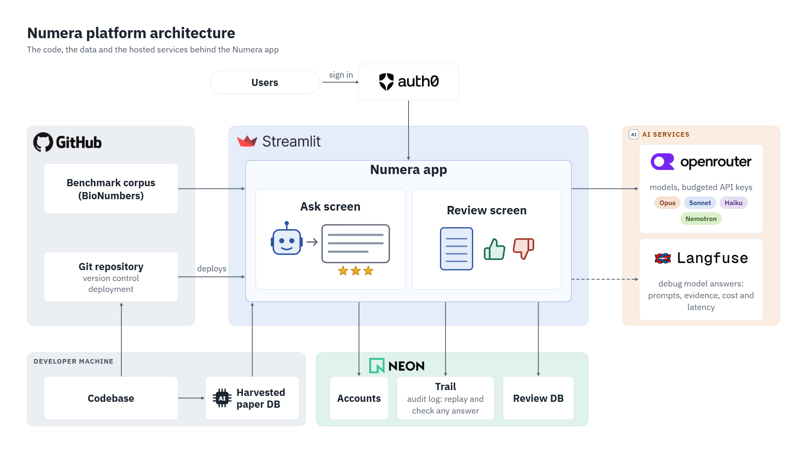

# Numera

**How long is an E. coli cell? How many ribosomes does it carry?** Quantitative biology runs on
numbers like these, and the usual way to get one out of a language model is to ask and hope. A
plausible number arrives with no way to tell whether it was recalled, interpolated, or invented.

Numera answers only from numbers it can point to, and **rates how far each one has been checked**.
Citing a source is not enough on its own: a number extracted from a paper can still be misread. So
every number in an answer cites its entry, and every entry carries a trust rating: hand-curated
[BioNumbers](https://bionumbers.hms.harvard.edu) values at the top, then values extracted from
open-access papers and approved by a reviewer, down to ones nobody has checked yet. Where its sources do not cover a question, it says so rather than answering from the
model's own knowledge. It is for people who need a figure they can defend.

It has two sides:

- **Ask.** A scientist asks a question in plain language. An agent searches the entries, answers,
  and lists the entries it used beside the answer, each with its source and its trust rating.
- **Review.** People check the extracted numbers against the paper they came from, and their
  verdicts set each entry's rating. Until there are enough reviewers, models stand in for them,
  and everything they decide is labelled as simulated.

Four commitments shape the design:

- **Provenance.** Every figure in an answer carries a numbered marker that leads to its entry:
  the value, the quote from the paper, and the paper's full reference. A citation to an entry the
  agent never actually retrieved is flagged rather than quietly printed.
- **Trust you can see.** Each entry is rated from five stars (curated by BioNumbers) down to one
  (approved only by an AI reviewer), or none if nobody has approved it yet. A warning sign marks an
  entry a reviewer objected to. The ratings come from the database, never from the model.
- **Precision.** Units are compared by dimension, so a length is never silently reconciled with a
  volume. A value is shown as the paper wrote it, ranges and uncertainties included, and one with
  no measurement method, or that the source only bounded or approximated, is marked as such.
- **Reliability.** Spending is capped per question and per reader, conversations have a length
  limit, and every question ends with a stated reason and what it cost. Nothing the agent can call
  is able to change an entry.

> **A prototype, not an instrument.** More careful than a general-purpose model, but
> not yet scientifically trustworthy: verify every number against the original source
> before relying on it. What has been measured is retrieval, not truth — see the
> evaluation below — and every review so far has been a simulated one.

## How it works

The agent is a LangGraph loop with the entries behind three search tools. Its graph, generated from
the compiled agent rather than drawn:


The graph shows only part of it: retries, error handling and most of the spending checks wrap each
model and tool call rather than appearing as boxes.
[`docs/diagrams/architecture.md`](docs/diagrams/architecture.md) lists them in order, follows one
question from start to finish, and shows which modules may depend on which.

The agent is kept apart from the interfaces that drive it (ports and adapters). The web page, a
terminal client and the evaluation harness all drive the same agent, and it is never told which
one is calling, so it cannot behave one way for a person and another for a test.

### Where the numbers come from

The first version went from a question to the literature: search for papers, then extract the
number. It found the right paper 4 times in 32, because a paper that mentions a property and an
organism rarely measures them. So the pipeline turned round. **Papers are harvested ahead of any
question**: a model reads each open-access paper once and extracts the numbers a scientist outside
the study would want to reuse, with the exact sentence or table cell each came from. Every quote is
then checked mechanically against the paper's text, and a value whose quote cannot be found is
dropped. So far that is about 450 values from 48 papers, across cell biology, physiology,
biophysics, chemistry and physics, beside 420 curated BioNumbers entries on yeast and the
cytoskeleton.

**Trust is earned afterwards, through review.** The review screen is built so that clicking
"approve" is not enough. The reviewer first sees two passages from the paper, with nothing
highlighted, and has to pick the one that states the value and type the value they read. Only then
is the extracted entry revealed for approval. The second passage is sometimes a decoy, and the
record keeps which it was. The most senior role that approves an entry (senior scientist,
scientist, student, or an AI reviewer) sets its stars.

What reviewers write never reaches the model. The harvesting and review pipeline is a prototype:
it ran to fill the current database and is not running continuously.

### Rating an answer

Each answer has a thumbs up and a thumbs down. A thumbs down opens a box asking what was wrong, and
the place to name an entry you think is wrong. Ratings are stored with the question they judge, so
a complaint can be read next to exactly what the agent retrieved for it.

Comments are read by the people running the app and are **never sent to the model**. They are text
written by strangers, and a tool whose wrong answers look like its right ones must not take
instructions that way.

## Running it

Requires Python 3.12+, [uv](https://docs.astral.sh/uv/) and an [OpenRouter](https://openrouter.ai)
API key. The database of harvested papers is not distributed, so to try Numera yourself, run it
over the BioNumbers download.

```bash
uv sync --extra ask --extra ingest
export OPENROUTER_API_KEY=...
```

**Get the corpus.** Download the BioNumbers database from
<https://bionumbers.hms.harvard.edu/resources.aspx> and put `BioNumbers.xls` in a directory
**outside this repository**: its licensing is unresolved, so nothing derived from it may be
committed.

```bash
export NUMERA_CORPUS=~/bionumbers/bionumbers.jsonl   # BioNumbers.xls is in ~/bionumbers/
uv run streamlit run streamlit_app.py
```

The first start builds the corpus from the download, which takes about a minute. Then ask
something: `What is the minimal inhibitory concentration of kanamycin for E. coli?` is a good first
question, because the source says `<8` and the answer says so rather than reporting 8 as a
measurement.

Configuration, the command-line tools, the harvesting pipeline and the tests are in the
[development guide](docs/development.md); hosting it with sign-in is in the [deployment
guide](docs/deployment.md).

## The platform



The goal was a real multi-user app, hosted on a zero budget, without building a front end from
scratch. Each service does one job, and each was picked because its free tier covers it:

- **Streamlit Community Cloud** hosts the app. The whole interface is Python, which is what made a
  polished front end affordable for one developer. But the platform has no notion of a user, and
  its disk is wiped on every redeploy, which is why everything below it exists.
- **Auth0** signs readers in, by email or with their Google account. Only a confirmed address gets
  in, and only if the operator has given it access.
- **Neon** (serverless Postgres) holds what must survive a redeploy: the accounts, the **trail**
  (an audit log of every question, its answer, the evidence behind it and any rating, so any answer
  can be checked afterwards) and the reviewers' decisions.
- **OpenRouter** reaches the models through one API, so switching between Opus, Sonnet, Haiku or an
  open model is a setting. Each tester gets their own API key with its own spending cap.
- **Langfuse** (optional) traces a single question in full: every prompt, tool call, token and
  timing. It is for debugging an answer, not for keeping records; the trail does that.
- **GitHub** holds the code, deploys the app, and runs the scheduled jobs that keep it awake.
- The **developer machine** runs the harvesting pipeline that fills the paper database.

## What else is in here

The parts a first-time visitor would not see from the screen. The details are in the [deployment
guide](docs/deployment.md), the [development guide](docs/development.md) and the [decision
records](docs/decisions/).

- **Spend is capped per question, per budget period, and per tester**, each tester through their
  own key. A question that hits its cap shows what it had found, marked incomplete.
- **Sign-in and roles.** Five roles, from student to admin; anything not explicitly allowed is
  refused. Nothing about the reader's role reaches the agent, so an answer cannot depend on who
  asked. Giving a tester access, or taking it away, is one command that also issues or revokes
  their capped key.
- **The sign-in page plays a demo**: real questions put to the agent and their real answers
  (shortened), typed out and streamed in a loop, so a visitor sees what the app does before signing
  in.
- **The app notices people who cannot get in.** A daily check lists anyone stuck at sign-in (never
  got the confirmation email, or confirmed but not yet given access), and an alert says when a new
  reader first signs in or asks. Both stay silent when there is nothing to report, so their
  messages are worth opening.
- **It stays awake on a free tier.** Streamlit hibernates an idle app after 12 hours; a scheduled
  job visits it with a headless browser and wakes it, and reports once a day if that failed.
- **About 3,000 tests** drive the real agent with scripted models instead of mocking the
  framework, and need no API key. Defects are seeded on purpose to check the tests would catch them.
- **Decisions are written down as they are made:** 90-odd [architecture decision
  records](docs/decisions/), and the app's behaviour specified in [OpenSpec](openspec/specs/).

## Evaluating the answers

An evaluation harness puts a fixed set of questions to the same agent the web page uses, and
records everything that came back. Scores are computed afterwards from those records, so a scoring
rule can be fixed and the whole baseline re-scored without paying for the questions again. The runs
so far were over the BioNumbers database; evaluating over the harvested papers is planned.

**Results never enter the repository.** Every result contains BioNumbers text, whose licence is
unresolved, so the harness refuses to write anywhere git would track.

### What it measures, by example

Ten questions, three repeats each, 2026-09-17 — the run that chose the default model
([full findings](docs/evaluations/2026-09-17-three-models.md)). Questions are tiered: `basic` is one
property of one organism, `compound` needs a comparison or a calculation.

| | Haiku 4.5 | **Opus 4.7** | MiniMax M2.7 |
|---|---:|---:|---:|
| Expected entries reaching the table | 53% | **65%** | 9% |
| — on `basic` questions | 70% | 68% | 12% |
| — on `compound` questions | 31% | **62%** | 6% |
| Unsupported questions correctly declined | 4 of 6 | **6 of 6** | 6 of 6 |
| Cost per 30 questions | $0.40 | $2.89 | $0.29 |

**The whole of Opus's lead is the compound questions** — on lookups the two Claude models are a tie.
So the model choice buys multi-organism comparisons and calculations, not better lookups, which is
what the tiering exists to show. The figure that is not about coverage: Haiku answered two of the six
unsupported questions with a quantity instead of saying the corpus does not hold it, which is the
failure this app is most meant to avoid.

Read no single repeat. The same comparison at one repeat each, that morning, had the two models a
point apart and looked like a tie.

Earlier runs are in [`docs/evaluations/`](docs/evaluations/). How to run an evaluation is in the
[development guide](docs/development.md#evaluating-the-answers).

## What it does not do

Nothing writes to the entries, and nothing the agent can call is able to create, change or delete
one. The agent does not search the literature or fetch papers itself; harvesting happens
beforehand, and its results reach the agent only through the paper database.

**Nothing yet judges whether a sentence is true.** A cited entry is checked against what was
retrieved, but the quantities written in the prose are not, and nothing yet judges an answer's
claims one by one. That is planned, not built.

**A rating does not change the answer it is about.** It is evidence for whoever improves the tool,
and it reaches them, not the agent.

**Tracing is not masked.** When switched on, a question's full text, tool results and answer go to
Langfuse unredacted. Its free tier keeps them 30 days, and the app never reads them back.

## Where to read next

- [`docs/diagrams/architecture.md`](docs/diagrams/architecture.md) — the middleware stack, one
  question as a sequence, and which modules may depend on which
- [Why an agent rather than a search box](openspec/changes/archive/2026-09-03-add-ask-agent/proposal.md)
  — the original proposal, with what was deferred and why
- [Why harvest papers ahead of the question](openspec/changes/archive/2026-10-15-add-harvest-prototype/proposal.md)
  — the turn from searching per question to harvesting, and the curated tier
- The behaviour, as specifications: [answering from the entries](openspec/specs/grounded-answering/spec.md)
  and [the review screen](openspec/specs/review-task/spec.md); all of them are in
  [`openspec/specs/`](openspec/specs/)
- [`docs/roadmap.md`](docs/roadmap.md) — what is done, what is next, and why in that order
- [`docs/decisions/`](docs/decisions/) — every design decision, with the options it rejected

To cite BioNumbers itself: Milo et al. *Nucl. Acids Res.* (2010) 38 (suppl 1): D750–D753.

## Licence

**No licence is granted.** The code is published to be read; all rights are reserved, © 2026
DukeOfErl. That is a deliberate choice for a portfolio repository, not an oversight — ask if you
want to reuse something.

Some material here was never ours to license. The open-access papers under
`tests/fixtures/europepmc/` keep the licences stated in each file. BioNumbers is the work of its
authors: the six-entry test fixture, the question set and the values quoted in the evaluation
findings are used with their permission, and the database itself is not in this repository
(ADR-0170).

