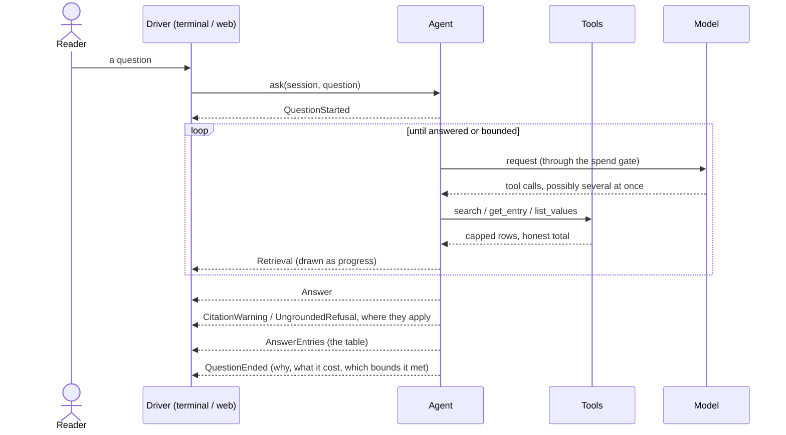
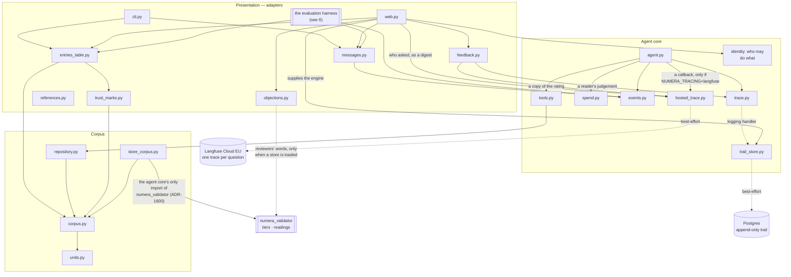
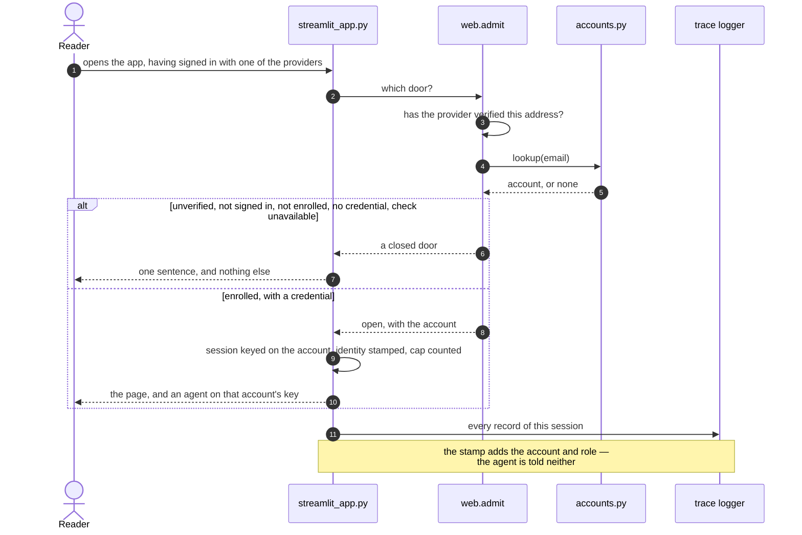
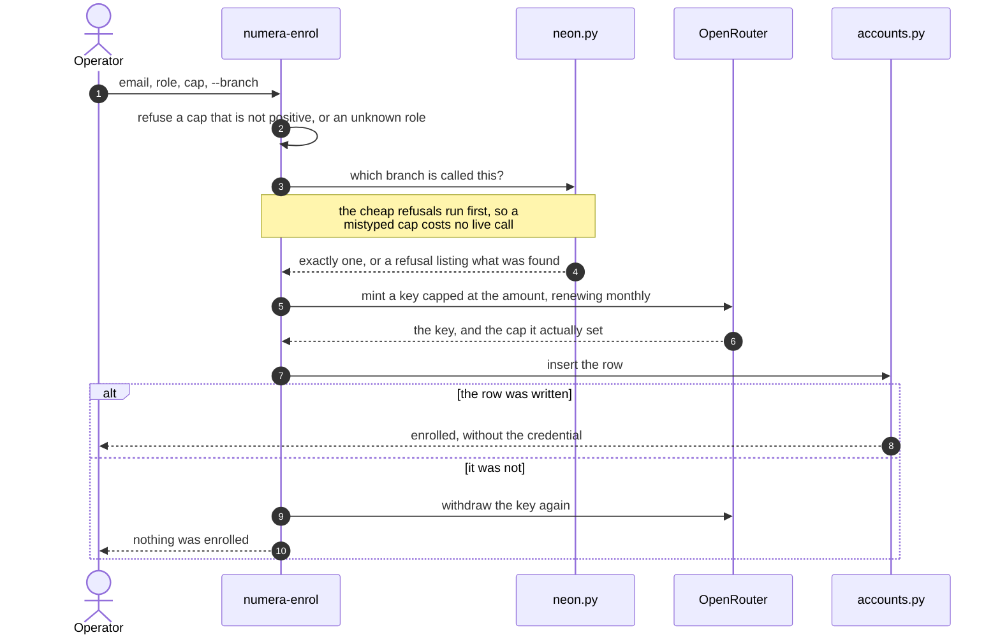
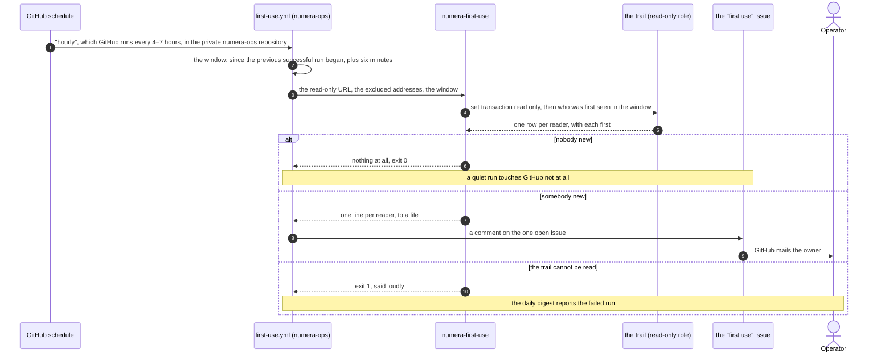
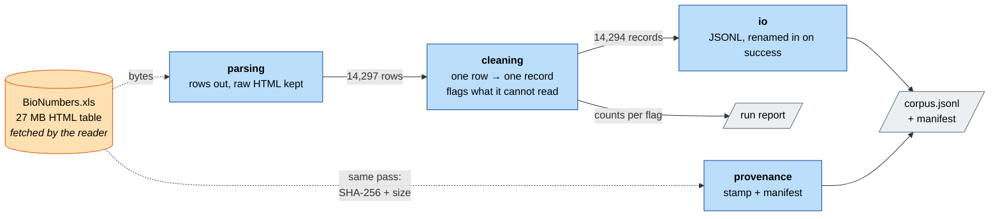
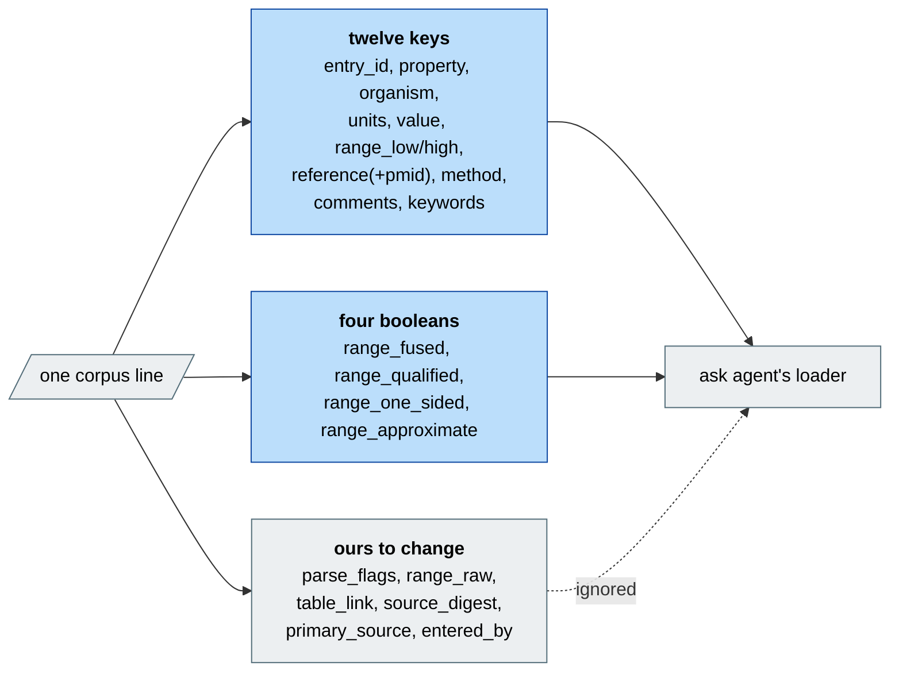
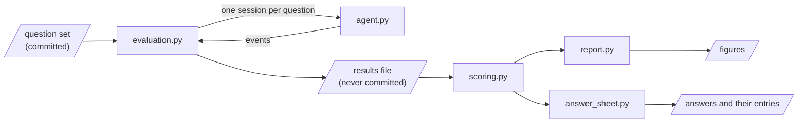
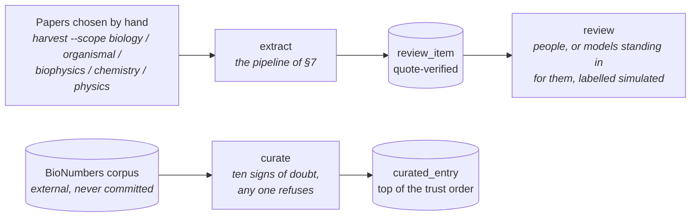
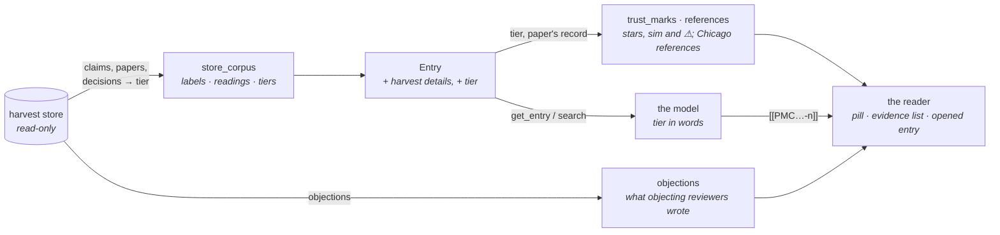

# Architecture diagrams

Fourteen diagrams, one story each, following `DIAGRAMS.md`. Sections 1–3d are the ask agent and
the operations around it, 4 and 5 the ingester that builds its corpus, 6 the evaluation harness that
measures it, and 7–7d the harvest store: how it is filled, reviewed, and read by the agent. Colour,
where it is used, encodes kind of thing: orange for an external API, blue for a deterministic
component, grey for a model call.

## 1. The agent's graph

**Generated, not drawn** — from `agent.get_graph().draw_mermaid()` on the compiled
object, because the nodes and edges are chosen by LangChain from the middleware
list. A hand-drawn version would record what was intended rather than what was
built. Regenerate whenever middleware is added, removed or reordered, or a
`jump_to` edge changes.


**What the graph cannot show.** Only `before_model` / `after_model` hooks become
nodes. `wrap_model_call` and `wrap_tool_call` middleware are wrappers around the
`model` and `tools` nodes, so they are invisible here — and they are where most of
the behaviour lives. Their nesting order is the list order, outermost first:

| # | Middleware | Kind | What it does |
|---|---|---|---|
| 1 | `ModelRetryMiddleware` | wraps model | Retries transient provider failures; `on_failure="error"` so an outage surfaces rather than becoming an answer |
| 2 | `ToolErrorMiddleware` | wraps tools | Turns a raised tool error into something the agent can react to |
| 3 | `ToolRetryMiddleware` | wraps tools | Retries a failing tool. **Inner to 2 deliberately** — the other order converts every exception to a `ToolMessage` before retry sees one, so retries silently never happen |
| 4 | `ModelCallLimitMiddleware` | node hooks | Bounds model calls per question; `exit_behavior="error"` so the limit is named rather than injected as an answer |
| 5 | `SpendGate` | wraps model; also an `after_model` node | Innermost, so every retry attempt passes through it. Declines the call when a limit is reached — not asking the model to stop, not issuing the request (ADR-0120) |

The retrieval bound is not here at all: it lives in the tools themselves
(`ToolBudget`, ADR-0260), because a model batches several tool calls into one hop
and a node-level count cannot see them.

## 2. What happens during one question



Every arrow out of the agent is an event; it never writes to an interface and
never blocks for input (ADR-0110). The warnings sit between the answer and the
entries deliberately: a reader meets the caveat before the evidence.

## 3. Modules, and what may depend on what



*Caption: which modules exist, and what each may depend on.*

`hosted_trace.py` is the one module that names the hosted tracer. The agent reaches it at its single
stream call, for a callback and for the refusal of the framework vendor's own tracing; the page
reaches it only to attach an opaque digest around a question it is drawing; `feedback.py` reaches it
to copy a rating. None of those paths can change an answer, and all of them do nothing unless
tracing is switched on (ADR-1010, ADR-1020). The agent's graph (section 1) is unchanged by it:
callbacks are not nodes, and the middleware list is the same.

`identity` is three modules — `permissions.py` (the roles and the grant table as
data), `authorization.py` (`require`, called inside the operation it guards) and
`accounts.py` (enrolment off one row, failing closed). They are one box because
this diagram answers "what may depend on what", and to that question they are one
thing: core, reached by the driver, reaching nothing but each other. The inventory
belongs in `CLAUDE.md`'s module table, which is the right form for a list. What
they *do*, in order, is the next diagram rather than more arrows on this one.

## 3b. What happens when a reader opens the page



*Caption: what the page decides before it draws anything, and where identity
joins the trail. The refusals are one branch because they differ only in the
sentence shown; ADR-0830 says why the session is keyed on the account.*

**The verification check is drawn before the lookup because that is where it
is**, and the order is the point rather than a detail of the drawing: an
unverified address never reaches the accounts table. Where sign-up at a provider
is open, the claim is the only thing separating an enrolled tester from anyone
who registers their address (ADR-0890). The reader arrives having chosen one of
the configured providers; which one they used is not part of the session key and
is not stamped on anything, because the address is the identity (ADR-0880).

## 3c. What happens when the operator enrols a tester



*Caption: two systems with no transaction between them, and what a half-done
enrolment leaves behind. Everything that can be refused from the arguments alone
is refused before any live call; the branch is resolved before the mint, so a
mistyped name is free too. ADR-0900.*

The cap and role checks belong to `enrol`, not to the command, and `enrol` runs
them — the command runs the same expression of them first only so that
`--limit-usd 0` does not spend two control-plane calls before anything says no.
A review found this diagram drawn in the order the code *should* have run rather
than the order it did; the code moved to match the drawing, which was the right
way round here because the drawing was the better design.

**The order is the decision.** Inserting first would leave a row with no key —
a door of its own, where the tester is told no credential has been issued and the
operator sees an account that looks deliberately keyless rather than half-made.
Minting first leaves, at worst, a capped key nobody refers to, and the command
withdraws it on the way out. Where the withdrawal fails too, the key is named so
a person can revoke it by hand; that is the one outcome this leaves work for.

**The identity modules are core so that the refusal is reachable without a
browser**, and `test_driver_independence.py` names them as such on purpose
(ADR-0800). **The agent is built per session, handed a credential and nothing
else about the person** (ADR-0820): the driver stamps `user_email` and
`user_role` onto trail records with a `logging.Filter` on `trace`'s logger, so
`agent.py`, `trace.py` and `feedback.py` never hold either, and a structural
test parses all three for any identifier that would mean otherwise.
`.claude/rules/identity.md` carries the rest, beside the code it describes.

**The dotted arrows are the trail, and neither is a dependency.** `trace.py` does
not import `trail_store`: the store attaches itself as a second handler on
`trace`'s logger, which is why no call site changed when it was added. And the
write to Postgres fails open — the question is answered whether or not the row
lands (ADR-0710).

`web.py` supplies the engine because only a driver may know about `st.connection`;
`trail_store` itself imports no framework, which is what keeps it on the core side
of the line rather than beside `autobuild` in presentation.

**`feedback.py` is in presentation, and that side is the whole guarantee.** A
rating is a reader's judgement and a comment is text a stranger wrote — the one
input to this system authored to be read by the people running it. Put it in the
core and nothing structural stops a prompt reaching the model by that route, in a
tool whose wrong answers look exactly like its right ones (ADR-0750). So a
rating's path is entirely left-to-right on this diagram: reader → `feedback.py` →
`trace.py`'s logger → `trail_store` → Postgres, joining the question's own rows on
the identifier they share. The agent has no arrow to it, and
`test_driver_independence.py` asserts that no core module may acquire one — under
`PRESENTATION`, which is wider than the driver set the older test checks.

Those rows now include the question as asked, the answer as given and the entries
behind it, written by `agent.ask` on the same logger (ADR-0840). The arrow is the
same one; what travels along it grew. Nothing new points at the model — these are
records of a question already answered, and the same test holds that line.

**The one rule with a direction: no arrow runs from the core back into
presentation.** Nothing in Python enforces it — an `import streamlit` in the tool
layer would work perfectly and weld the agent to one interface — so
`tests/test_driver_independence.py` asserts it over the source.

`entries_table.py` and `messages.py` are shared *by* the drivers and sit on the
presentation side, which is why the span rule that both the table and the model
need lives on `Entry` (`corpus.py`) instead: the agent must not reach across the
line to get it.

The harness is collapsed to one box here because this diagram's story is the
direction of dependency, and on that question it is simply a third adapter: it
consumes the same events `cli` and `web` do, and the agent takes no parameter
naming its caller (ADR-0110). Its own modules are section 6. It carries one rule
the interactive drivers do not — it may not reach for a terminal, or the thing
meant to run unattended would need one.

## 3d. What happens when a reader may have just arrived



*Caption: the command keeps no state. "First" is read out of the trail on each run
(ADR-1250). GitHub fires this "hourly" schedule only every 4–7 hours, so the window
is not a fixed length: it reaches back to when the previous successful run began, plus
six minutes, so nobody falls in a gap and only the overlap repeats (ADR-1290). The job holds a role that can read one table (ADR-1260), and the report
goes to a file and an issue, never the run's log. Job and issue live in the private
DukeOfErl/numera-ops, not in this public repository; it runs this repository's
command unchanged (ADR-2050, superseding ADR-1280).*

## 4. Ingestion: how the published export becomes a corpus

*What happens when someone runs `bionumbers-ingest`?* A pipeline whose two ends are the only stages
that know a file format — the HTML reader in, the JSONL writer out. Nothing between them knows either.



Two things the boxes cannot show:

- **The source is hashed in the same pass that parses it**, which is why `provenance` hangs off the
  export rather than sitting after the writer. Hashing separately would mean a second read, and a
  second read could see a different file than the one that produced the records.
- **Records are held in memory between `cleaning` and `io`**, not streamed. Every record carries a
  digest of the *whole* source, which is not known until the last byte — so the arrow from cleaning to
  the writer is a list, not a stream. That costs about 70 MB and is the trade-off recorded in
  [ADR-0240](../decisions/0240-stamp-every-ingest.md).

## 5. What a consumer reads, and what it ignores

*Which parts of a corpus line are a contract, and which are ours to change?*



The twelve keys and their types are what the loader enforces; it ignores every other key, which is
what lets the flags and the provenance stamp be added without touching it. The four booleans are the
contract terms a consumer should read **instead of** matching on flag names — the names behind them
are cleaning's own vocabulary and may be renamed, split or dropped. The last two arrived because the
consumer was reading `range_approximate` and `range_one_sided` out of `parse_flags` by name to choose
the wording it shows a reader, and a rename here would have turned those silently false there rather
than failing
([ADR-0230](../decisions/0230-flag-and-count-never-correct.md), [ADR-0210](../decisions/0210-verifying-a-contract-owned-by-another-branch.md)).

## 6. The evaluation harness: from a question set to a figure

*What does a run actually do with a question, and where does each artefact come
from?*



**The results file is the seam, and it holds no scores.** Each line carries the
question, the answer, the entries cited and retrieved, the context the agent was
shown and what produced it — so every figure to the right of it is recomputable
without asking a question again. That is what let a scoring rule be corrected
twice, and a mis-built expected list be corrected twice more, for nothing.

**Two things never cross back into the repository.** The results file and the
answer sheet both carry corpus text — the first verbatim, the second through the
entries it tabulates — so both ask git whether it would track the path and refuse
to write if it would (ADR-0170, ADR-0250).

**What is not here:** the judged layer, which reads a results file and writes
judgements to a file of its own. It is deferred to `add-judged-faithfulness`.

## 7. The harvest pipeline: from papers to review items

```mermaid
sequenceDiagram
    autonumber
    actor Operator
    participant CLI as numera-validator harvest / extract
    participant EPMC as Europe PMC
    participant Reader as jats.py
    participant Model as one extraction call
    participant Check as quotes.verify
    participant Second as one second-text call
    Operator->>CLI: papers chosen by hand (PMCIDs), a scope
    CLI-->>EPMC: full text per paper, and its licence (cached on disk)
    CLI->>Reader: XML → passages with ids
    alt no methods section
        Reader-->>CLI: NOT_A_RESEARCH_ARTICLE, no call
    else
        CLI-->>Model: instruction + the paper (cached prefix)
        Model-->>Check: claims, each quoting a passage id
        Check-->>Model: failures, once
        Check-->>CLI: verified claims; the rest dropped as unverifiable
        CLI-->>Second: for each claim, on the cached paper
        Second-->>CLI: a distractor or a second occurrence, or no item
    end
    CLI->>CLI: results.jsonl, items.jsonl under data/runs/<run-id>/
```

*Caption: one paper's path through a fixed pipeline with at most three model
calls and no tools (ADR-1520). Runs start from papers chosen by hand (ADR-0950);
the first version started from a property question and searched Europe PMC
(`discover`), which is kept but no longer used. Every quote a reviewer will see has passed the
checker; a paper ends in exactly one named state (ADR-1530), and a call that would
cross the $2 ceiling is not made.*

There is no agent graph here because there is no agent: the extractor is one
structured-output call with the whole paper in its system block, retried once
with the checker's failures named. Grey boxes are model calls; the second one
reads the paper at the cached rate because the paper block precedes the
instruction in both. Which second text an item got — distractor, and of which
type, or a second legitimate occurrence — is stored on the item and never shown
(ADR-1540).

## 7a. What the store holds: harvested and curated



*Caption: two ways in, one store. Harvested entries start at "quote verified" and
rise as reviewers decide (ADR-0950, ADR-1500); BioNumbers entries enter at the
top, but only where the record itself gives no cause for doubt (ADR-1510). The
trust tier is derived from decisions, not stored.*

## 7b. A review decision

```mermaid
sequenceDiagram
    autonumber
    actor Reviewer
    participant Page as review_app.py
    participant Door as web.admit
    participant Store as store.py
    participant DB as the review store
    Reviewer->>Page: opens the review page
    Page->>Door: which door? (no credential needed)
    Door-->>Page: open, with the account, or closed
    Page->>Store: next_item(reviewer)
    Store-->>DB: an undecided item, a half-done one first
    Page-->>Reviewer: question, citation, texts A and B — no value
    Reviewer->>Page: which text states a value, and the value read
    Page->>Store: record_choice(...)
    Store-->>DB: one open row: choice and value read, no verdict
    Page-->>Reviewer: the stored value, the paper's term, the conditions
    Reviewer->>Page: approve or disapprove, comment
    Page->>Store: record_verdict(...)
    alt the write fails
        Store-->>Page: DecisionNotSaved
        Page-->>Reviewer: not saved; the same screen stays
    else
        Store-->>DB: the row completed, with the time of both steps
        Page-->>Reviewer: the next item, and how many remain
    end
```

*Caption: the door is the ask app's, imported; the store is not the trail's. It is
whatever `[connections.review]` or `NUMERA_REVIEW_DB_URL` names: a SQLite file
locally, Postgres when hosted (ADR-2000). The page has not been deployed yet. A
decision is two writes on one row (ADR-0970): the choice and the value read go
in before the stored value is shown, so the reading cannot have been steered by
it. Each write fails closed (ADR-0930), which is the opposite of the trail's
choice (ADR-0710) for the reason the ADR gives: here the row is the product.
Not shown: an issue may be raised at either step in place of what remains.*

## 7c. A simulated review

```mermaid
sequenceDiagram
    autonumber
    actor Operator
    participant CLI as numera-validator simulate-review
    participant Sim as simulated_review.py
    participant Screen as review.py
    participant Model as model (OpenRouter)
    participant Store as store.py
    Operator->>CLI: --reviewer ROLE=MODEL@SHARE, a budget
    CLI->>Sim: run(reviewers)
    loop each reviewer, each of its undecided items
        Sim->>Sim: assigned(role, item)? else skip
        Sim->>Screen: texts in the page's order, citation — no value
        Sim->>Sim: project the cost; refuse past either bound
        Sim->>Model: the choice instruction, the first screen
        Model-->>Sim: A or B and the value read, or an issue
        Sim->>Store: record_choice / record_issue, with role, model, answerer
        Sim->>Screen: the reveal: value, the paper's term, conditions
        Sim->>Model: the verdict instruction, the reveal
        Model-->>Sim: approve or disapprove, or an issue
        Sim->>Store: record_verdict / record_issue
    end
    Sim-->>Operator: a summary marked simulated
```

*Caption: a second driver over the review task, standing where the page and
the person stand in 7b (ADR-0960, ADR-0970). The model is shown one screen per
step and nothing else, every role gets the same instruction, and every row
records the model asked for and the one that answered. What the diagram cannot
show: the budget and an account refusal stop the whole run, a failed step skips
one item, and a run started again continues from the rows already written — an
item left after its first step gets only its second.*

## 7d. The ask agent over the store: what it reads, and what it is never shown



*Caption: the store's claims and papers become entries, and its decisions become one tier per
entry by ADR-0990's rule. The model is told the tier in words; the reader is shown it as stars,
drawn by the application (ADR-1630). The review's own text — the passage that tests a reviewer,
and anything a reviewer wrote — is put into no entry, so the model never sees it. What objecting
reviewers wrote does reach the reader, by its own path (`objections.py`, presentation, ADR-1630):
in the Trust cell and the opened entry. What is saved about
an answer is the store's item id beside each label (ADR-1610). A paper's record, with its
authors, goes the same way as the tier: formatted for the reader (ADR-1640), never shown to the
model, which is told to cite entries and name no paper.*
