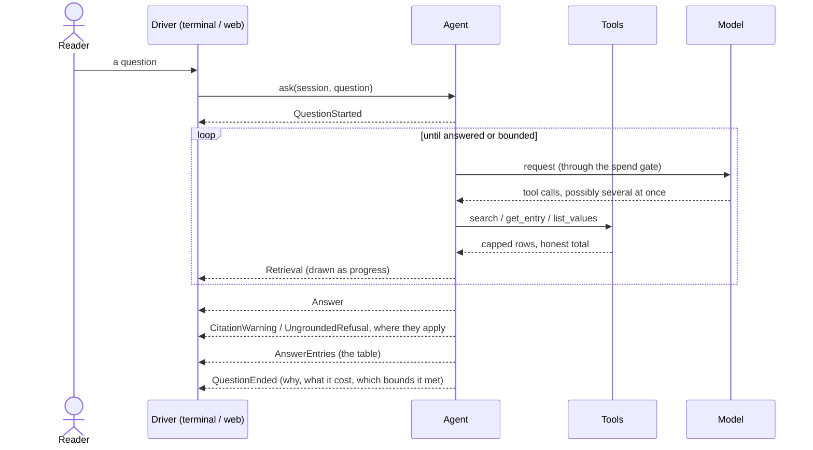
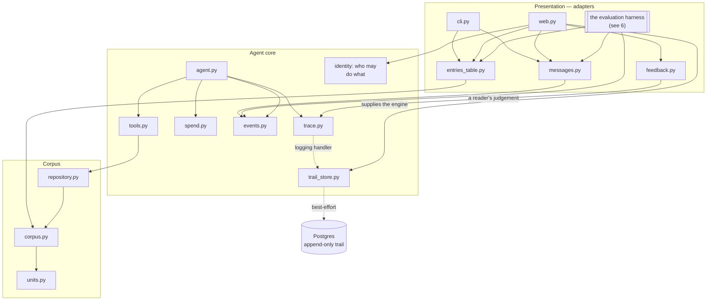
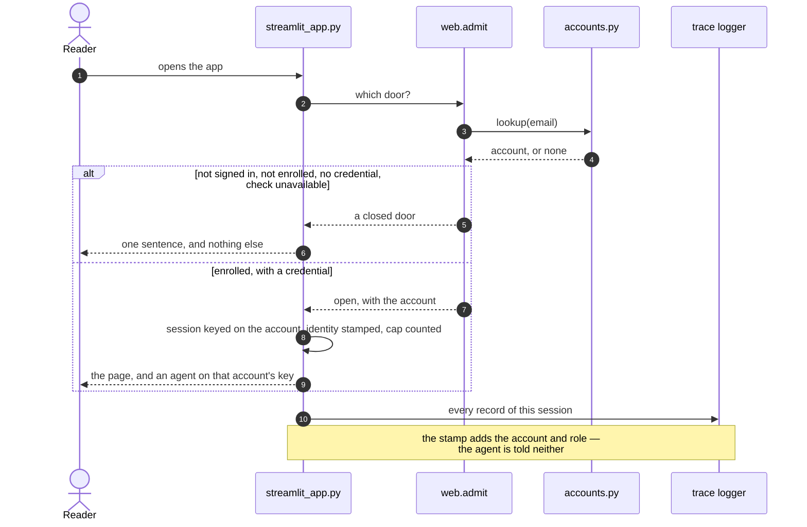
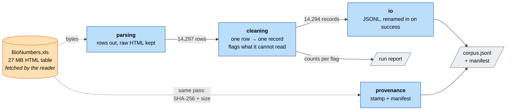
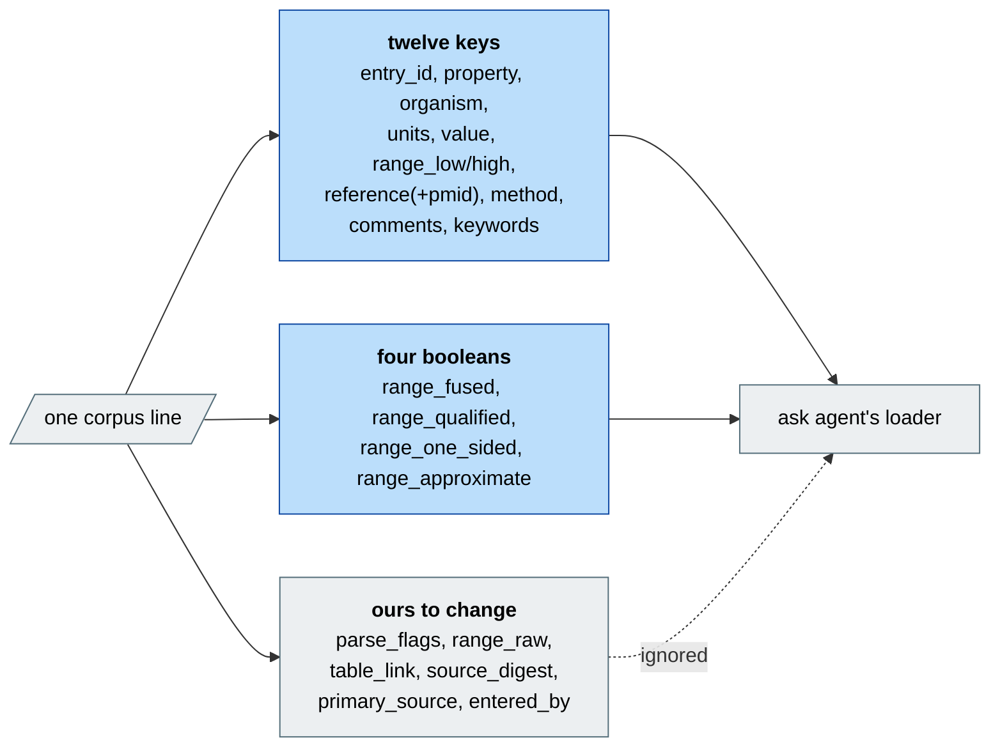
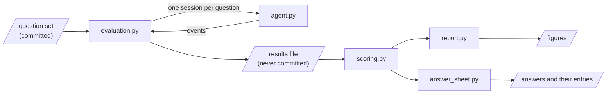
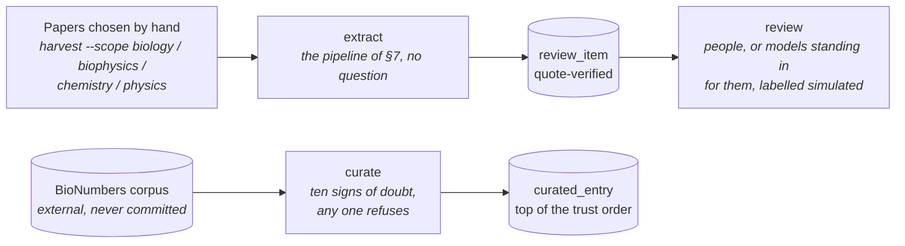

# Architecture diagrams

Seven diagrams, one story each, following `DIAGRAMS.md`. Sections 1–3b are the ask agent, 4 and 5
the ingester that builds its corpus, and 6 the evaluation harness that measures it. Colour, where it
is used, encodes kind of thing: orange for an external input, blue for a deterministic component,
grey for an output artefact.

## 1. The agent's graph

**Generated, not drawn** — from `agent.get_graph().draw_mermaid()` on the compiled
object, because the nodes and edges are chosen by LangChain from the middleware
list. A hand-drawn version would record what was intended rather than what was
built. Regenerate whenever middleware is added, removed or reordered, or a
`jump_to` edge changes.


**What the graph cannot show.** Only `before_model` / `after_model` hooks become
nodes. `wrap_model_call` and `wrap_tool_call` middleware are wrappers around the
`model` and `tools` nodes, so they are invisible here — and they are where most of
the behaviour lives. Their nesting order is the list order, outermost first:

| # | Middleware | Kind | What it does |
|---|---|---|---|
| 1 | `ModelRetryMiddleware` | wraps model | Retries transient provider failures; `on_failure="error"` so an outage surfaces rather than becoming an answer |
| 2 | `ToolErrorMiddleware` | wraps tools | Turns a raised tool error into something the agent can react to |
| 3 | `ToolRetryMiddleware` | wraps tools | Retries a failing tool. **Inner to 2 deliberately** — the other order converts every exception to a `ToolMessage` before retry sees one, so retries silently never happen |
| 4 | `ModelCallLimitMiddleware` | node hooks | Bounds model calls per question; `exit_behavior="error"` so the limit is named rather than injected as an answer |
| 5 | `SpendGate` | wraps model | Innermost, so every retry attempt passes through it. Declines the call when a limit is reached — not asking the model to stop, not issuing the request (ADR-0120) |

The retrieval bound is not here at all: it lives in the tools themselves
(`ToolBudget`, ADR-0260), because a model batches several tool calls into one hop
and a node-level count cannot see them.

## 2. What happens during one question



Every arrow out of the agent is an event; it never writes to an interface and
never blocks for input (ADR-0110). The warnings sit between the answer and the
entries deliberately: a reader meets the caveat before the evidence.

## 3. Modules, and what may depend on what



*Caption: which modules exist, and what each may depend on.*

`identity` is three modules — `permissions.py` (the roles and the grant table as
data), `authorization.py` (`require`, called inside the operation it guards) and
`accounts.py` (enrolment off one row, failing closed). They are one box because
this diagram answers "what may depend on what", and to that question they are one
thing: core, reached by the driver, reaching nothing but each other. The inventory
belongs in `CLAUDE.md`'s module table, which is the right form for a list. What
they *do*, in order, is the next diagram rather than more arrows on this one.

## 3b. What happens when a reader opens the page



*Caption: what the page decides before it draws anything, and where identity
joins the trail. The refusals are one branch because they differ only in the
sentence shown; ADR-0830 says why the session is keyed on the account.*

**The identity modules are core so that the refusal is reachable without a
browser**, and `test_driver_independence.py` names them as such on purpose
(ADR-0800). **The agent is built per session, handed a credential and nothing
else about the person** (ADR-0820): the driver stamps `user_email` and
`user_role` onto trail records with a `logging.Filter` on `trace`'s logger, so
`agent.py`, `trace.py` and `feedback.py` never hold either, and a structural
test parses all three for any identifier that would mean otherwise.
`.claude/rules/identity.md` carries the rest, beside the code it describes.

**The dotted arrows are the trail, and neither is a dependency.** `trace.py` does
not import `trail_store`: the store attaches itself as a second handler on
`trace`'s logger, which is why no call site changed when it was added. And the
write to Postgres fails open — the question is answered whether or not the row
lands (ADR-0710).

`web.py` supplies the engine because only a driver may know about `st.connection`;
`trail_store` itself imports no framework, which is what keeps it on the core side
of the line rather than beside `autobuild` in presentation.

**`feedback.py` is in presentation, and that side is the whole guarantee.** A
rating is a reader's judgement and a comment is text a stranger wrote — the one
input to this system authored to be read by the people running it. Put it in the
core and nothing structural stops a prompt reaching the model by that route, in a
tool whose wrong answers look exactly like its right ones (ADR-0750). So a
rating's path is entirely left-to-right on this diagram: reader → `feedback.py` →
`trace.py`'s logger → `trail_store` → Postgres, joining the question's own rows on
the identifier they share. The agent has no arrow to it, and
`test_driver_independence.py` asserts that no core module may acquire one — under
`PRESENTATION`, which is wider than the driver set the older test checks.

Those rows now include the question as asked, the answer as given and the entries
behind it, written by `agent.ask` on the same logger (ADR-0840). The arrow is the
same one; what travels along it grew. Nothing new points at the model — these are
records of a question already answered, and the same test holds that line.

**The one rule with a direction: no arrow runs from the core back into
presentation.** Nothing in Python enforces it — an `import streamlit` in the tool
layer would work perfectly and weld the agent to one interface — so
`tests/test_driver_independence.py` asserts it over the source.

`entries_table.py` and `messages.py` are shared *by* the drivers and sit on the
presentation side, which is why the span rule that both the table and the model
need lives on `Entry` (`corpus.py`) instead: the agent must not reach across the
line to get it.

The harness is collapsed to one box here because this diagram's story is the
direction of dependency, and on that question it is simply a third adapter: it
consumes the same events `cli` and `web` do, and the agent takes no parameter
naming its caller (ADR-0110). Its own modules are section 6. It carries one rule
the interactive drivers do not — it may not reach for a terminal, or the thing
meant to run unattended would need one.

## 4. Ingestion: how the published export becomes a corpus

*What happens when someone runs `bionumbers-ingest`?* A pipeline whose two ends are the only stages
that know a file format — the HTML reader in, the JSONL writer out. Nothing between them knows either.



Two things the boxes cannot show:

- **The source is hashed in the same pass that parses it**, which is why `provenance` hangs off the
  export rather than sitting after the writer. Hashing separately would mean a second read, and a
  second read could see a different file than the one that produced the records.
- **Records are held in memory between `cleaning` and `io`**, not streamed. Every record carries a
  digest of the *whole* source, which is not known until the last byte — so the arrow from cleaning to
  the writer is a list, not a stream. That costs about 70 MB and is the trade-off recorded in
  [ADR-0240](../decisions/0240-stamp-every-ingest.md).

## 5. What a consumer reads, and what it ignores

*Which parts of a corpus line are a contract, and which are ours to change?*



The twelve keys and their types are what the loader enforces; it ignores every other key, which is
what lets the flags and the provenance stamp be added without touching it. The four booleans are the
contract terms a consumer should read **instead of** matching on flag names — the names behind them
are cleaning's own vocabulary and may be renamed, split or dropped. The last two arrived because the
consumer was reading `range_approximate` and `range_one_sided` out of `parse_flags` by name to choose
the wording it shows a reader, and a rename here would have turned those silently false there rather
than failing
([ADR-0230](../decisions/0230-flag-and-count-never-correct.md), [ADR-0210](../decisions/0210-verifying-a-contract-owned-by-another-branch.md)).

## 6. The evaluation harness: from a question set to a figure

*What does a run actually do with a question, and where does each artefact come
from?*



**The results file is the seam, and it holds no scores.** Each line carries the
question, the answer, the entries cited and retrieved, the context the agent was
shown and what produced it — so every figure to the right of it is recomputable
without asking a question again. That is what let a scoring rule be corrected
twice, and a mis-built expected list be corrected twice more, for nothing.

**Two things never cross back into the repository.** The results file and the
answer sheet both carry corpus text — the first verbatim, the second through the
entries it tabulates — so both ask git whether it would track the path and refuse
to write if it would (ADR-0170, ADR-0250).

**What is not here:** the judged layer, which reads a results file and writes
judgements to a file of its own. It is deferred to `add-judged-faithfulness`.

## 7. The validator prototype: from a question to review items

```mermaid
sequenceDiagram
    autonumber
    actor Operator
    participant CLI as bionumbers discover / extract
    participant EPMC as Europe PMC
    participant Reader as jats.py
    participant Model as one extraction call
    participant Check as quotes.verify
    participant Second as one second-text call
    Operator->>CLI: a property question, an organism
    CLI-->>EPMC: search: open access, research articles, PMCID
    CLI-->>EPMC: full text per paper (cached on disk)
    CLI->>Reader: XML → passages with ids
    alt no methods section
        Reader-->>CLI: NOT_A_RESEARCH_ARTICLE, no call
    else
        CLI-->>Model: instruction + the paper (cached prefix)
        Model-->>Check: claims, each quoting a passage id
        Check-->>Model: failures, once
        Check-->>CLI: verified claims; the rest dropped as unverifiable
        CLI-->>Second: for each claim, on the cached paper
        Second-->>CLI: a distractor or a second occurrence, or no item
    end
    CLI->>CLI: results.jsonl, items.jsonl under data/runs/<run-id>/
```

*Caption: one paper's path through a fixed pipeline with at most three model
calls and no tools (ADR-1520). Every quote a reviewer will see has passed the
checker; a paper ends in exactly one named state (ADR-1530), and a call that would
cross the $2 ceiling is not made.*

There is no agent graph here because there is no agent: the extractor is one
structured-output call with the whole paper in its system block, retried once
with the checker's failures named. Grey boxes are model calls; the second one
reads the paper at the cached rate because the paper block precedes the
instruction in both. Which second text an item got — distractor, and of which
type, or a second legitimate occurrence — is stored on the item and never shown
(ADR-1540).

## 7a. What the store holds: harvested and curated



*Caption: two ways in, one store. Harvested entries start at "quote verified" and
rise as reviewers decide (ADR-0950, ADR-1500); BioNumbers entries enter at the
top, but only where the record itself gives no cause for doubt (ADR-1510). The
trust tier is derived from decisions, not stored.*

## 7b. A review decision

```mermaid
sequenceDiagram
    autonumber
    actor Reviewer
    participant Page as review_app.py
    participant Door as web.admit
    participant Store as store.py
    participant DB as Neon Postgres
    Reviewer->>Page: opens the review page
    Page->>Door: which door? (no credential needed)
    Door-->>Page: open, with the account, or closed
    Page->>Store: next_item(reviewer)
    Store-->>DB: an undecided item, papers interleaved
    Page-->>Reviewer: value, conditions, citation, texts A and B
    Reviewer->>Page: which text fits, approve or disapprove, comment
    Page->>Store: record_decision(...)
    alt the write fails
        Store-->>Page: DecisionNotSaved
        Page-->>Reviewer: not saved; the same item stays
    else
        Store-->>DB: one row, with the reviewer and the time
        Page-->>Reviewer: the next item, and how many remain
    end
```

*Caption: the door is the ask app's, imported; the store is not the trail's. A
decision is written the moment it is given and the write fails closed
(ADR-0930), which is the opposite of the trail's choice (ADR-0710) for the
reason the ADR gives: here the row is the product.*
