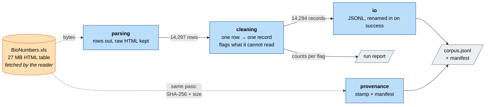
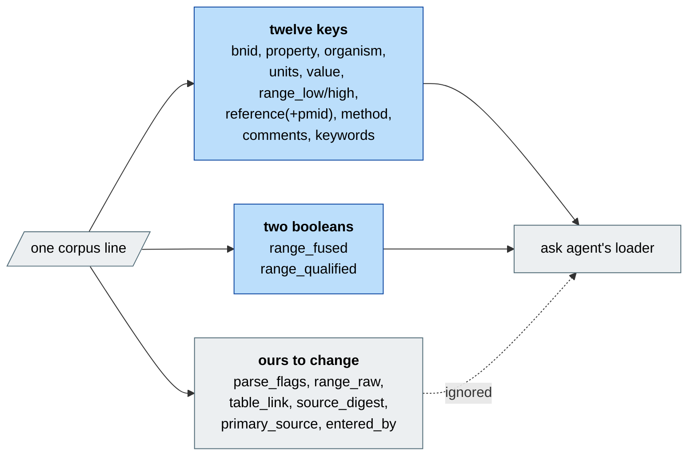

# Architecture diagrams

One diagram per story, per [`DIAGRAMS.md`](DIAGRAMS.md). Colour encodes kind of thing: orange for an
external input, blue for a deterministic component, grey for an output artefact.

## Ingestion: how the published export becomes a corpus

*What happens when someone runs `bionumbers-ingest`?* A pipeline whose two ends are the only stages
that know a file format — the HTML reader in, the JSONL writer out. Nothing between them knows either.

Two things the boxes cannot show:

- **The source is hashed in the same pass that parses it**, which is why `provenance` hangs off the
  export rather than sitting after the writer. Hashing separately would mean a second read, and a
  second read could see a different file than the one that produced the records.
- **Records are held in memory between `cleaning` and `io`**, not streamed. Every record carries a
  digest of the *whole* source, which is not known until the last byte — so the arrow from cleaning to
  the writer is a list, not a stream. That costs about 70 MB and is the trade-off recorded in
  [ADR-0240](../decisions/0240-stamp-every-ingest.md).

## What a consumer reads, and what it ignores

*Which parts of a corpus line are a contract, and which are ours to change?*

The twelve keys and their types are what the loader enforces; it ignores every other key, which is
what lets the flags and the provenance stamp be added without touching it. The two booleans are the
contract terms a consumer should read **instead of** matching on flag names — the names behind them
are cleaning's own vocabulary and may be renamed, split or dropped
([ADR-0230](../decisions/0230-flag-and-count-never-correct.md), [ADR-0210](../decisions/0210-verifying-a-contract-owned-by-another-branch.md)).
