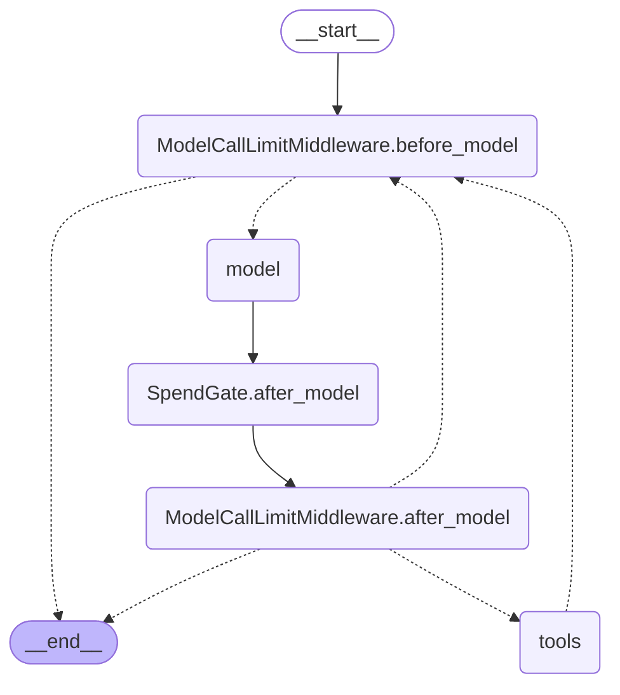
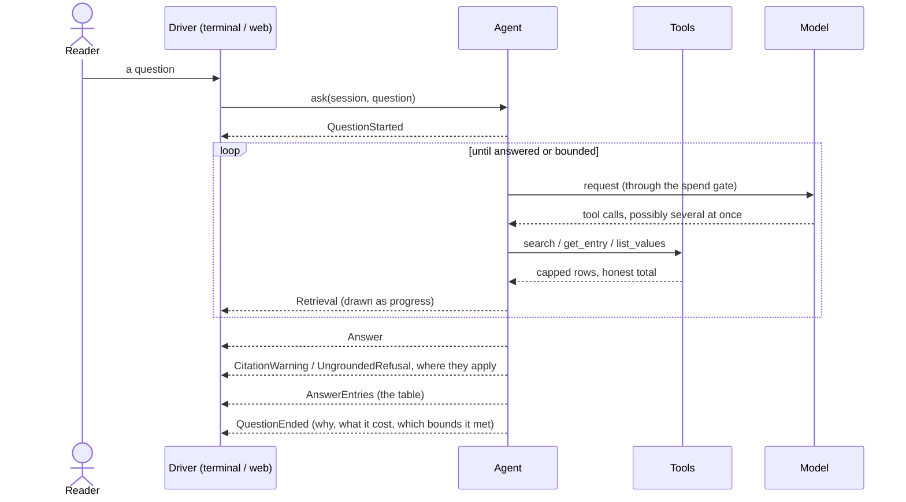
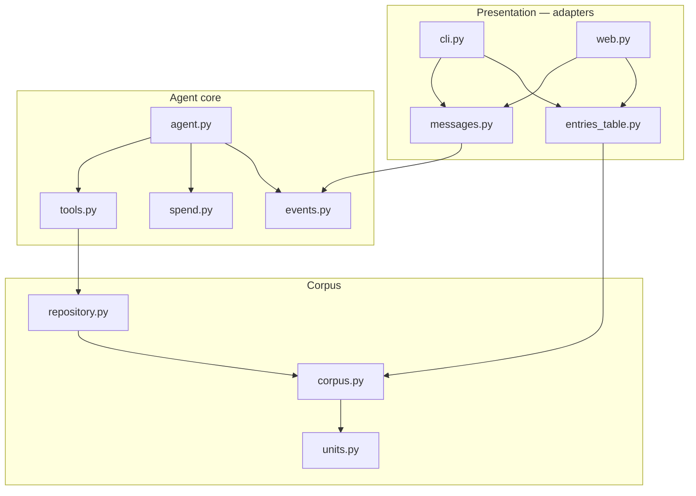

# Architecture diagrams

Three diagrams, one story each, following `DIAGRAMS.md`.

## 1. The agent's graph

**Generated, not drawn** — from `agent.get_graph().draw_mermaid()` on the compiled
object, because the nodes and edges are chosen by LangChain from the middleware
list. A hand-drawn version would record what was intended rather than what was
built. Regenerate whenever middleware is added, removed or reordered, or a
`jump_to` edge changes.

**What the graph cannot show.** Only `before_model` / `after_model` hooks become
nodes. `wrap_model_call` and `wrap_tool_call` middleware are wrappers around the
`model` and `tools` nodes, so they are invisible here — and they are where most of
the behaviour lives. Their nesting order is the list order, outermost first:

| # | Middleware | Kind | What it does |
|---|---|---|---|
| 1 | `ModelRetryMiddleware` | wraps model | Retries transient provider failures; `on_failure="error"` so an outage surfaces rather than becoming an answer |
| 2 | `ToolErrorMiddleware` | wraps tools | Turns a raised tool error into something the agent can react to |
| 3 | `ToolRetryMiddleware` | wraps tools | Retries a failing tool. **Inner to 2 deliberately** — the other order converts every exception to a `ToolMessage` before retry sees one, so retries silently never happen |
| 4 | `ModelCallLimitMiddleware` | node hooks | Bounds model calls per question; `exit_behavior="error"` so the limit is named rather than injected as an answer |
| 5 | `SpendGate` | wraps model | Innermost, so every retry attempt passes through it. Declines the call when a limit is reached — not asking the model to stop, not issuing the request (ADR-0120) |

The retrieval bound is not here at all: it lives in the tools themselves
(`ToolBudget`, ADR-0260), because a model batches several tool calls into one hop
and a node-level count cannot see them.

## 2. What happens during one question

Every arrow out of the agent is an event; it never writes to an interface and
never blocks for input (ADR-0110). The warnings sit between the answer and the
entries deliberately: a reader meets the caveat before the evidence.

## 3. Modules, and what may depend on what

**The one rule with a direction: no arrow runs from the core back into
presentation.** Nothing in Python enforces it — an `import streamlit` in the tool
layer would work perfectly and weld the agent to one interface — so
`tests/test_driver_independence.py` asserts it over the source.

`entries_table.py` and `messages.py` are shared *by* the drivers and sit on the
presentation side, which is why the span rule that both the table and the model
need lives on `Entry` (`corpus.py`) instead: the agent must not reach across the
line to get it.
