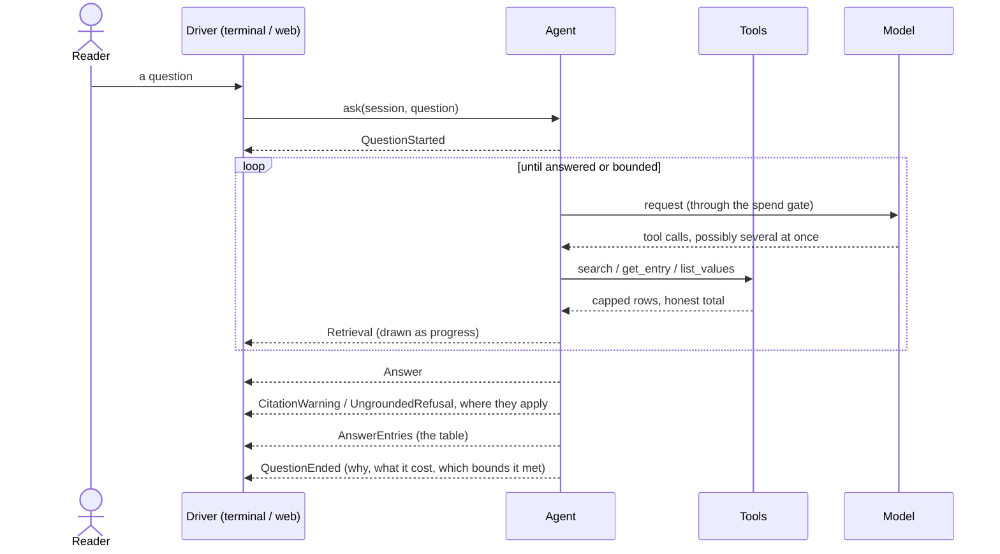
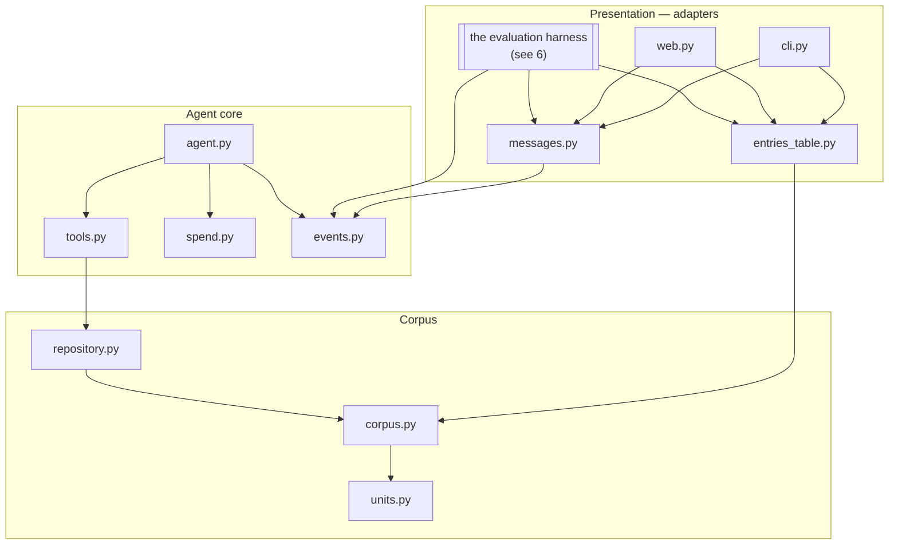
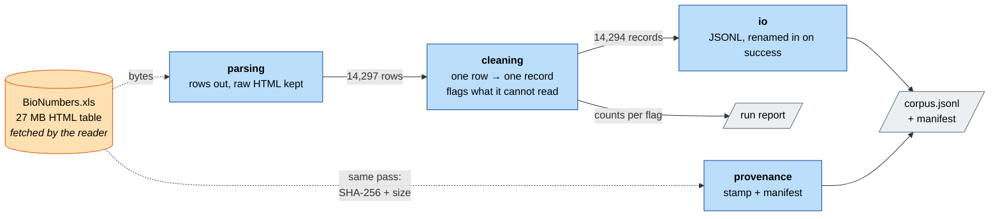
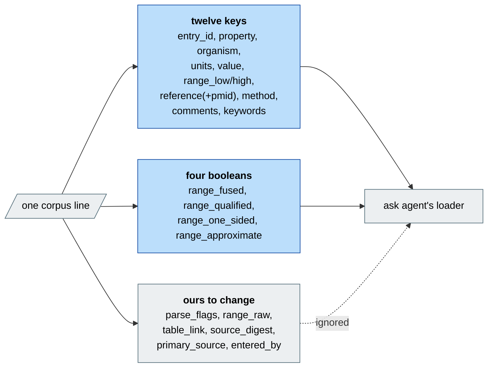
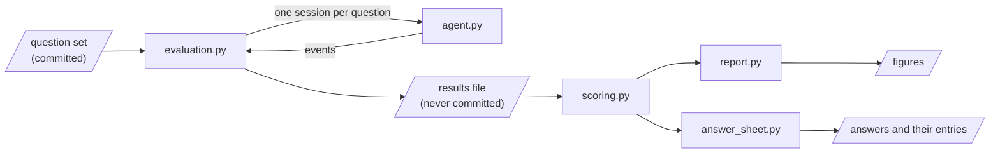

# Architecture diagrams

Five diagrams, one story each, following `DIAGRAMS.md`. The first three are the ask agent, the last
two the ingester that builds its corpus. Colour, where it is used, encodes kind of thing: orange for
an external input, blue for a deterministic component, grey for an output artefact.

Three diagrams, one story each, following `DIAGRAMS.md`.

## 1. The agent's graph

**Generated, not drawn** — from `agent.get_graph().draw_mermaid()` on the compiled
object, because the nodes and edges are chosen by LangChain from the middleware
list. A hand-drawn version would record what was intended rather than what was
built. Regenerate whenever middleware is added, removed or reordered, or a
`jump_to` edge changes.

**What the graph cannot show.** Only `before_model` / `after_model` hooks become
nodes. `wrap_model_call` and `wrap_tool_call` middleware are wrappers around the
`model` and `tools` nodes, so they are invisible here — and they are where most of
the behaviour lives. Their nesting order is the list order, outermost first:

| # | Middleware | Kind | What it does |
|---|---|---|---|
| 1 | `ModelRetryMiddleware` | wraps model | Retries transient provider failures; `on_failure="error"` so an outage surfaces rather than becoming an answer |
| 2 | `ToolErrorMiddleware` | wraps tools | Turns a raised tool error into something the agent can react to |
| 3 | `ToolRetryMiddleware` | wraps tools | Retries a failing tool. **Inner to 2 deliberately** — the other order converts every exception to a `ToolMessage` before retry sees one, so retries silently never happen |
| 4 | `ModelCallLimitMiddleware` | node hooks | Bounds model calls per question; `exit_behavior="error"` so the limit is named rather than injected as an answer |
| 5 | `SpendGate` | wraps model | Innermost, so every retry attempt passes through it. Declines the call when a limit is reached — not asking the model to stop, not issuing the request (ADR-0120) |

The retrieval bound is not here at all: it lives in the tools themselves
(`ToolBudget`, ADR-0260), because a model batches several tool calls into one hop
and a node-level count cannot see them.

## 2. What happens during one question

Every arrow out of the agent is an event; it never writes to an interface and
never blocks for input (ADR-0110). The warnings sit between the answer and the
entries deliberately: a reader meets the caveat before the evidence.

## 3. Modules, and what may depend on what

**The one rule with a direction: no arrow runs from the core back into
presentation.** Nothing in Python enforces it — an `import streamlit` in the tool
layer would work perfectly and weld the agent to one interface — so
`tests/test_driver_independence.py` asserts it over the source.

`entries_table.py` and `messages.py` are shared *by* the drivers and sit on the
presentation side, which is why the span rule that both the table and the model
need lives on `Entry` (`corpus.py`) instead: the agent must not reach across the
line to get it.

The harness is collapsed to one box here because this diagram's story is the
direction of dependency, and on that question it is simply a third adapter: it
consumes the same events `cli` and `web` do, and the agent takes no parameter
naming its caller (ADR-0110). Its own modules are section 6. It carries one rule
the interactive drivers do not — it may not reach for a terminal, or the thing
meant to run unattended would need one.

## 4. Ingestion: how the published export becomes a corpus

*What happens when someone runs `bionumbers-ingest`?* A pipeline whose two ends are the only stages
that know a file format — the HTML reader in, the JSONL writer out. Nothing between them knows either.

Two things the boxes cannot show:

- **The source is hashed in the same pass that parses it**, which is why `provenance` hangs off the
  export rather than sitting after the writer. Hashing separately would mean a second read, and a
  second read could see a different file than the one that produced the records.
- **Records are held in memory between `cleaning` and `io`**, not streamed. Every record carries a
  digest of the *whole* source, which is not known until the last byte — so the arrow from cleaning to
  the writer is a list, not a stream. That costs about 70 MB and is the trade-off recorded in
  [ADR-0240](../decisions/0240-stamp-every-ingest.md).

## 5. What a consumer reads, and what it ignores

*Which parts of a corpus line are a contract, and which are ours to change?*

The twelve keys and their types are what the loader enforces; it ignores every other key, which is
what lets the flags and the provenance stamp be added without touching it. The four booleans are the
contract terms a consumer should read **instead of** matching on flag names — the names behind them
are cleaning's own vocabulary and may be renamed, split or dropped. The last two arrived because the
consumer was reading `range_approximate` and `range_one_sided` out of `parse_flags` by name to choose
the wording it shows a reader, and a rename here would have turned those silently false there rather
than failing
([ADR-0230](../decisions/0230-flag-and-count-never-correct.md), [ADR-0210](../decisions/0210-verifying-a-contract-owned-by-another-branch.md)).

## 6. The evaluation harness: from a question set to a figure

*What does a run actually do with a question, and where does each artefact come
from?*

**The results file is the seam, and it holds no scores.** Each line carries the
question, the answer, the entries cited and retrieved, the context the agent was
shown and what produced it — so every figure to the right of it is recomputable
without asking a question again. That is what let a scoring rule be corrected
twice, and a mis-built expected list be corrected twice more, for nothing.

**Two things never cross back into the repository.** The results file and the
answer sheet both carry corpus text — the first verbatim, the second through the
entries it tabulates — so both ask git whether it would track the path and refuse
to write if it would (ADR-0170, ADR-0250).

**What is not here:** the judged layer, which reads a results file and writes
judgements to a file of its own. It is deferred to `add-judged-faithfulness`.
